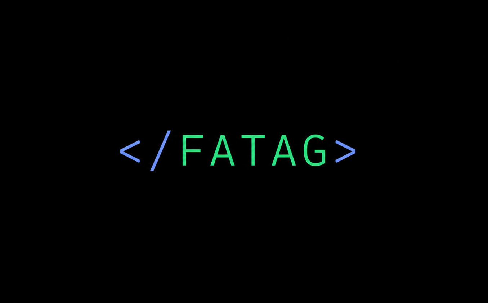

  

# </FATAG>

[Desafio](#-desafio) • [Requisitos](docs/requisitos.md) • [Backlog](docs/backlog.md) • [Sprints](#-sprints) • [DoR/DoD](#-dor--dod) • [Equipe](#-equipe) • [Como_Instalar](docs/instalação.md) • [API](docs/api.md) • [Manual_do_Usuário](docs/manual-do-usuario.md) • [Cronograma de Evolução](docs/cronograma.png) • [Pastas_do_Projeto](docs/Pastas_do_projeto.png) • [Padrão_de_Commit_do_Projeto](docs/Padrão%20de%20Commits.md)

> **Parceiro:** IPEM-SP · **Curso:** 3°ADS · **Período:** 2026-2
>
> **Status do Projeto:** Em desenvolvimento 🚧

---

## 🏭 Desafio

O IPEM-SP publica um grande volume de dados sobre a fiscalização de bombas medidoras de combustível, mas essa informação chega ao público em planilhas brutas, espalhadas entre o Portal de Dados Abertos do IPEM-SP e o PSIE do Inmetro. Os registros trazem inconsistências de nomes de municípios, formatos de data variados e colunas de medição sem padronização.

O resultado é um dado que existe, é público, mas não é consultável: o cidadão não consegue saber se as bombas da sua cidade estão em conformidade, e a própria gestão perde agilidade para identificar regiões críticas e padrões de reprovação.

Nesse contexto, o desafio é transformar essa base dispersa em informação clara, construindo um pipeline de tratamento e análise em Python e um painel web de consulta rápida sobre a conformidade das bombas de combustível fiscalizadas no estado de São Paulo.

---

## ⚙️ Desenvolvimento

O projeto é dividido em três partes:

| Parte | Pasta | O que faz |
| :---- | :---- | :-------- |
| 📓 **Notebook** (Python + Pandas) | [`notebook/`](notebook/testApi_py.ipynb) | Lê os CSVs do IPEM-SP (2018 a 2026), trata e padroniza os dados e exporta a base tratada em JSON. Também tem as análises que deram origem às funções da API. [Documentação](notebook/DOCUMENTACAO_testApi_py.md) · [Google Colab](https://colab.research.google.com/drive/1hZg6B7dlyYgenRo9yUHyZRV7iHlA0LvL?usp=sharing) |
| 🔌 **API** (Node.js + Express) | [`src/backend-node/`](src/backend-node) | Carrega a base tratada (`src/data/verificacoes_bombas_tratado.json`) e oferece as rotas de consulta, filtros, resumo, ranking e evolução por ano. [Documentação da API](docs/api.md) |
| 🖥️ **Dashboard** (React + TypeScript) | [`src/front-end/my-app/`](src/front-end/my-app) | Painel web com tabela, cards de KPI, gráficos interativos, ranking, mapa do Vale do Paraíba, filtros e relatórios em PDF, CSV e JSON. |

Para rodar o projeto, veja o guia de [instalação](docs/instalação.md).

---

## 🌳Estratégia de Branches

### Branch Principal:
- `main`: Branch de produção com código estável e funcional;

### Branch de Desenvolvimento:
- `develop`: Desenvolvimento da API que fornece os dados;
- `front-end`: Desenvolvimento do visual do site;
- `feat/docker`: Implementação do Docker no projeto;
- `feat/filtros`: Funções relacionadas aos filtros;
- `feat/interatividade`: Interatividade dos gráficos e do painel;
- `feat/relatorios`: Geração de relatórios (PDF, CSV e JSON);

### Branch de Correções:
- `fix/correcoes`: Correções e limpeza do código;

### Branch de Documentação:
  - `document`: Atualização da documentação.

---

## 📅 Sprints

| Sprint | Período | Meta | Documentação | Vídeo |
| :----- | :------ | :--- | :----------- | :---- |
| 🏃 **Sprint 1** | 07/09 – 27/09 | Consolidar os dados de fiscalização das bombas medidoras e disponibilizar os indicadores básicos de conformidade | [Docs](docs/sprints/sprint-1.md) | [Assistir](https://youtu.be/t0FCfCGjA-U) |
| 🏃 **Sprint 2** | 05/10 – 25/10 | Consultar os dados por município e região, gerar o ranking de municípios e regiões e comparar a evolução entre os anos | [Docs](docs/sprints/sprint-2/backlog.md) | [Assistir](https://youtu.be/fC_1P6IB1w8) |
| 🏃 **Sprint 3** | 02/11 – 22/11 | Entregar a dashboard interativa, com filtros por município, região e período, gráficos interativos e exportação dos registros tratados em CSV | [Docs](docs/sprints/sprint-3/backlog.md) | [Assistir](#) |

---

## 🚦 DoR & DoD

### 🏃‍ DoR - Definition of Ready

* User Stories com **Critérios de Aceitação**
* Subtarefas divididas **a partir das US**
* Fontes de dados **identificadas** (Portal de Dados Abertos do IPEM-SP e PSIE do Inmetro)
* Dicionário de dados com as **colunas relevantes** mapeadas
* Protótipo das telas no **Figma**
* User Stories **estimadas** e **priorizadas** no Backlog

### 🏆 DoD - Definition of Done

* Critérios de Aceitação **atendidos**
* Pipeline de tratamento dos dados **completo** (limpeza e padronização)
* Indicadores **validados** com a base de dados
* Código completo e **versionado** no GitHub
* Documentação do **Notebook** atualizada
* [Manual de Usuário](docs/manual-do-usuario.md)
* Vídeos de cada etapa de entrega

---

## 🧰 Tecnologias e ferramentas

**Front-end**  

**Back-end**  

**Tratamento e análise dos dados**  

**Infraestrutura e colaboração**  

---

## 👥 Equipe

| Membro | Função | GitHub | LinkedIn |
| :----- | :----- | :----- | :------- |
| João Barreto | Product Owner |  |  |
| Nicolas Escobar | Scrum Master |  |  |
| Elizabete Baltazar | Desenvolvedor(a) |  |  |
| Heitor Galvão | Desenvolvedor(a) |  |  |
| Miguel Duarte | Desenvolvedor(a) |  |  |
| Lucas Suzuki | Desenvolvedor(a) |  |  |
| Kamille Fernandes | Desenvolvedor(a) |  |  |
| Adler Rocha | Desenvolvedor(a) |  |  |

---

FATAG · 3º ADS · Fatec São José dos Campos · 2026-2

