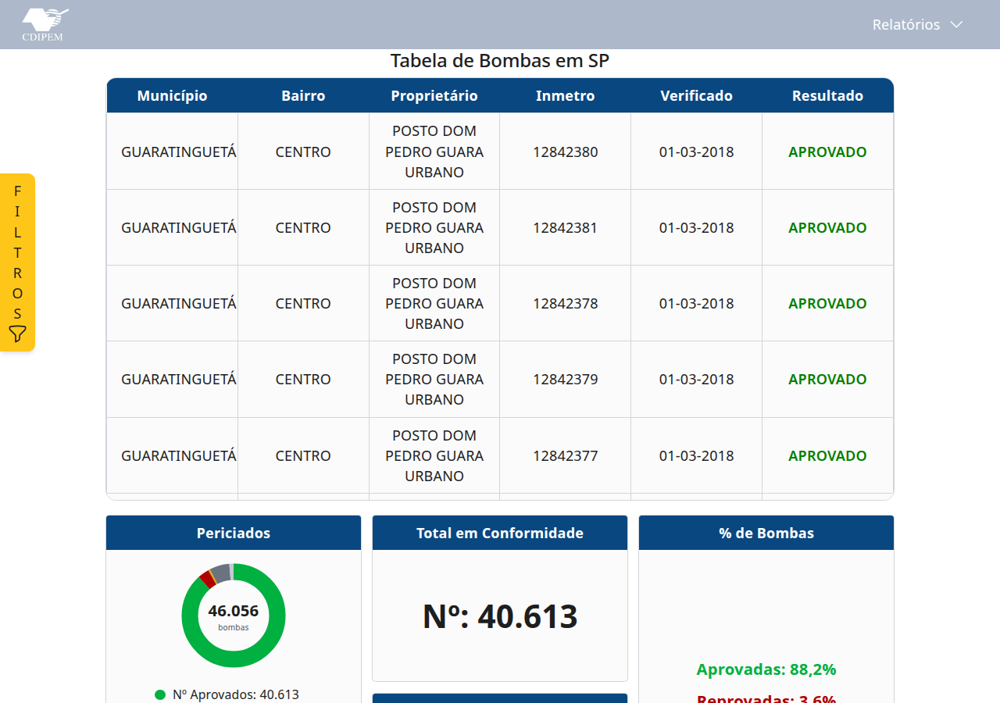
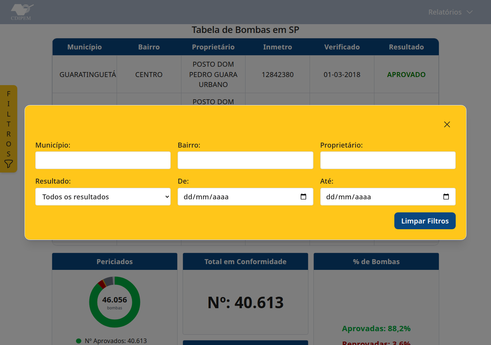
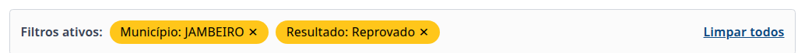
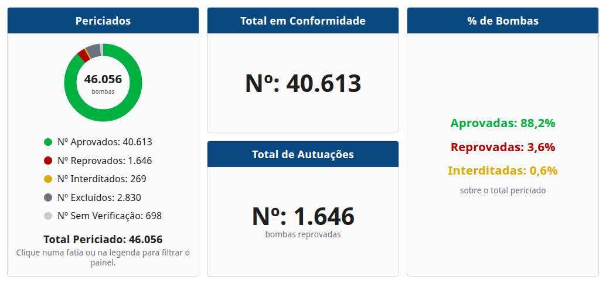
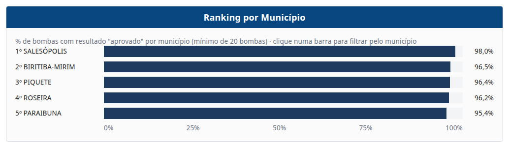
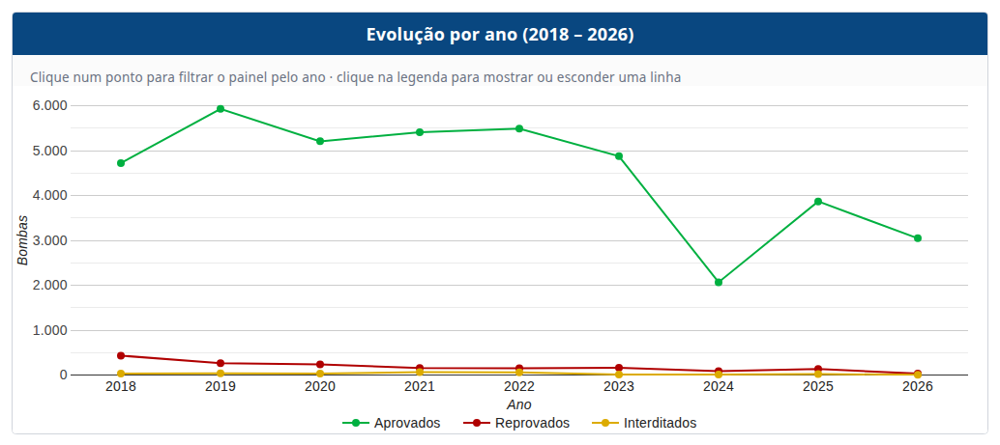
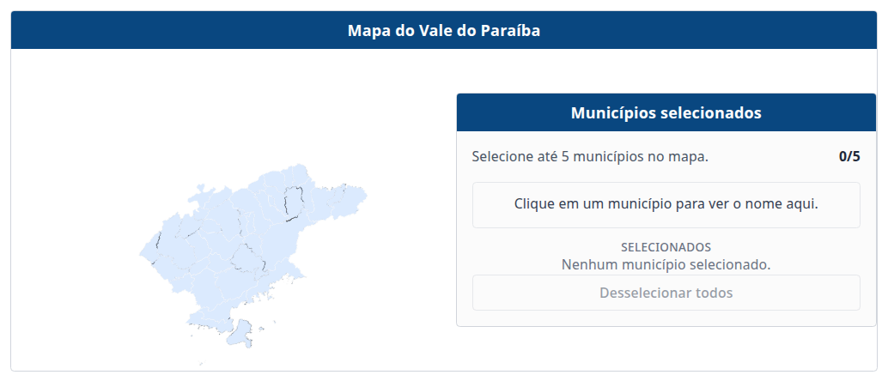
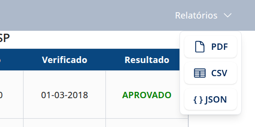

# 📘 Manual do Usuário

Este manual explica como usar o painel de consulta das fiscalizações de bombas de combustível do IPEM-SP.

O painel mostra os resultados das verificações feitas pelo IPEM-SP nas bombas medidoras de combustível da **regional de São José dos Campos**, de **janeiro de 2018 a setembro de 2026**: mais de 46 mil verificações. Com ele, você pode descobrir se as bombas da sua cidade estão em conformidade, comparar municípios e acompanhar a evolução ao longo dos anos.

> Para instalar e iniciar a aplicação, veja o [manual de instalação](instalação.md). Com a aplicação rodando, acesse **http://localhost:5173** no navegador.

## Sumário

1. [Visão geral da tela](#1-visão-geral-da-tela)
2. [Tabela de bombas](#2-tabela-de-bombas)
3. [Filtros](#3-filtros)
4. [Indicadores e gráfico de rosca](#4-indicadores-e-gráfico-de-rosca)
5. [Ranking por município](#5-ranking-por-município)
6. [Evolução por ano](#6-evolução-por-ano)
7. [Mapa do Vale do Paraíba](#7-mapa-do-vale-do-paraíba)
8. [Relatórios: PDF, CSV e JSON](#8-relatórios-pdf-csv-e-json)
9. [Entendendo os resultados](#9-entendendo-os-resultados)
10. [Dúvidas frequentes](#10-dúvidas-frequentes)

---

## 1. Visão geral da tela

O painel é uma página única. De cima para baixo:

| Parte | Para que serve |
| ----- | -------------- |
| **Menu "Relatórios"** (canto superior direito) | Baixar os dados em PDF, CSV ou JSON. |
| **Botão "FILTROS"** (lateral esquerda, em amarelo) | Abrir os filtros. |
| **Tabela de Bombas** | Lista de todas as verificações. |
| **Periciados, Total em Conformidade, Total de Autuações e % de Bombas** | Números gerais das fiscalizações. |
| **Ranking por Município** | Os municípios com os maiores percentuais. |
| **Evolução por ano** | Como os resultados mudaram de um ano para outro. |
| **Mapa do Vale do Paraíba** | Escolher municípios clicando no mapa. |

**Tudo no painel trabalha junto:** um filtro aplicado em qualquer lugar (nos filtros, num gráfico ou no mapa) vale para a página inteira e para os relatórios.

## 2. Tabela de bombas

A tabela mostra uma verificação por linha:

| Coluna | Significado |
| ------ | ----------- |
| **Município** e **Bairro** | Onde fica o posto. |
| **Proprietário** | Nome do posto. |
| **Inmetro** | Número da bomba no Inmetro. |
| **Verificado** | Data da verificação. |
| **Resultado** | Resultado da verificação (veja a [seção 9](#9-entendendo-os-resultados)). |

A tabela carrega os registros aos poucos: role até o fim dela para carregar mais.

## 3. Filtros

### Abrir os filtros

Clique no botão amarelo **FILTROS**, na lateral esquerda da tela.

| Campo | Como usar |
| ----- | --------- |
| **Município** | Digite o nome da cidade. Aparecem sugestões enquanto você digita. Não precisa de acento nem de letra maiúscula: "sao jose" encontra "SÃO JOSÉ DOS CAMPOS". |
| **Bairro** | Escolha primeiro o município: as sugestões mostram só os bairros dele. |
| **Proprietário** | Digite o nome completo do posto. |
| **Resultado** | Escolha Aprovado, Reprovado, Interditado, Excluído ou Sem Verificação. |
| **De** e **Até** | Período das verificações. Pode usar só um dos dois: só "De" mostra daquela data em diante; só "Até" mostra até aquela data. |

Os filtros são aplicados automaticamente, sem precisar de botão de confirmar. Para fechar a janela, clique no **✕**, fora da janela ou aperte **Esc**.

**Limpar Filtros** remove todos os filtros de uma vez.

### Ver e remover os filtros ativos

Quando há algum filtro aplicado, aparece a barra **Filtros ativos** acima da tabela:

- Clique no **✕** de um filtro para removê-lo.
- Clique em **Limpar todos** para remover todos.

> 💡 Os filtros também podem ser aplicados clicando nos gráficos e no mapa, como explicado nas próximas seções. Eles também aparecem nessa barra.

## 4. Indicadores e gráfico de rosca

| Bloco | O que mostra |
| ----- | ------------ |
| **Periciados** | Gráfico de rosca com a quantidade de bombas em cada resultado. O total fica no centro. |
| **Total em Conformidade** | Quantidade de bombas aprovadas. |
| **Total de Autuações** | Quantidade de bombas reprovadas. |
| **% de Bombas** | Percentual de aprovadas, reprovadas e interditadas sobre o total periciado. |

### Usando o gráfico de rosca

- **Passe o mouse** sobre uma fatia ou um item da legenda: a fatia se destaca e o centro mostra o percentual.
- **Clique** numa fatia ou num item da legenda para filtrar o painel por aquele resultado. Exemplo: clicar em "Reprovados" faz a tabela mostrar só bombas reprovadas, e o ranking passa a mostrar os municípios com mais reprovações.
- **Clique de novo** no mesmo item para remover o filtro.

Mesmo com um resultado escolhido, a rosca continua mostrando todas as fatias, com a escolhida em destaque, para você não perder a proporção.

## 5. Ranking por município

Mostra os 5 municípios com o maior **percentual** do resultado escolhido. Sem filtro de resultado, o ranking é de **aprovadas**; com o filtro "Reprovado", passa a ser de reprovadas, e assim por diante.

- Só entram municípios com **pelo menos 20 bombas** verificadas, para uma cidade com poucas bombas não aparecer em primeiro só por acaso.
- **Passe o mouse** numa barra para ver a posição e o percentual.
- **Clique** numa barra para filtrar o painel por aquele município. Ele também fica selecionado no mapa. Clique de novo para remover.

## 6. Evolução por ano

Mostra, para cada ano, a quantidade de bombas aprovadas (verde), reprovadas (vermelho) e interditadas (amarelo). O gráfico respeita os filtros: com um município escolhido, mostra a evolução só daquele município.

- **Passe o mouse** sobre um ponto para ver a quantidade e o percentual daquele ano.
- **Clique** num ponto para filtrar o painel inteiro por aquele ano. O ano fica marcado com uma linha vertical, e o botão **Ano ✕** aparece no topo do gráfico para remover o filtro.
- **Clique na legenda** (Aprovados, Reprovados, Interditados) para esconder ou mostrar uma linha. Isso não filtra o painel.

> ℹ️ Os dados de 2026 vão só até setembro, então o total desse ano é menor.

## 7. Mapa do Vale do Paraíba

- **Passe o mouse** sobre um município para ver o nome.
- **Clique** num município para selecioná-lo; o painel inteiro passa a mostrar só os municípios selecionados. Clique de novo para tirar a seleção.
- Dá para selecionar **até 5 municípios** pelo mapa, para comparar.
- **Desselecionar todos** limpa a seleção.

## 8. Relatórios: PDF, CSV e JSON

Clique em **Relatórios**, no canto superior direito, e escolha o formato:

Todos os relatórios respeitam os filtros aplicados. Sem filtros, trazem a base inteira.

| Formato | O que traz | Para quê |
| ------- | ---------- | -------- |
| **PDF** | Os critérios da consulta (filtros usados), o resumo dos resultados e o ranking. | Imprimir ou compartilhar um resumo. |
| **CSV** | Todos os registros filtrados, com as colunas da tabela e a descrição da bomba. | Abrir no Excel ou em outra planilha. |
| **JSON** | Os mesmos registros do CSV, em formato JSON. | Usar os dados em outros sistemas. |

**PDF:** o navegador abre a janela de impressão. Em "Destino", escolha **Salvar como PDF**.

**CSV:** o arquivo é salvo como `relatorio_bombas_<data>.csv`. Ele já vem preparado para o Excel: basta abrir com dois cliques, e as colunas e os acentos aparecem corretamente. Em outras planilhas, se pedido, use **ponto e vírgula (;)** como separador e a codificação **UTF-8**.

> Exportar a base inteira (mais de 46 mil registros) pode levar alguns segundos. O botão fica desabilitado até o arquivo ficar pronto.

## 9. Entendendo os resultados

Cada verificação recebe um dos resultados abaixo, conforme registrado pelo IPEM-SP:

| Resultado | Cor no painel |
| --------- | :-----------: |
| **Aprovado**: a bomba está em conformidade. | 🟢 verde |
| **Reprovado**: a bomba não passou na verificação; gera autuação. | 🔴 vermelho |
| **Interditado**: a bomba foi interditada pela fiscalização. | 🟡 amarelo |
| **Excluído** | ⚫ cinza |
| **Sem Verificação** | ⚪ cinza-claro |

Os percentuais de "% de Bombas" são calculados sobre **todas** as verificações, incluindo Excluído e Sem Verificação. Por isso, aprovadas + reprovadas + interditadas não somam 100%.

## 10. Dúvidas frequentes

**O painel mostra dados de todo o estado de São Paulo?**
Não. Os dados disponíveis são da regional de São José dos Campos do IPEM-SP: 40 municípios do Vale do Paraíba, da Serra da Mantiqueira, do Litoral Norte (Caraguatatuba e Ubatuba) e do Alto Tietê (como Salesópolis, Biritiba-Mirim e Guararema).

**Por que o meu município não aparece no ranking?**
O ranking mostra só os 5 primeiros e ignora municípios com menos de 20 bombas verificadas. Para ver o seu, filtre pelo município: os indicadores e o gráfico de evolução mostram os dados dele.

**Apliquei um filtro e o painel ficou vazio.**
A combinação de filtros não encontrou nenhuma verificação. Confira a barra **Filtros ativos** e remova algum filtro, ou clique em **Limpar todos**.

**Digitei o município e nada mudou na hora.**
O painel espera você parar de digitar por um instante antes de buscar, para não atualizar a cada letra.

**Apareceu uma mensagem de erro em vermelho.**
O painel não conseguiu falar com o servidor dos dados. Confira se a aplicação está rodando (veja o [manual de instalação](instalação.md)) e recarregue a página.
